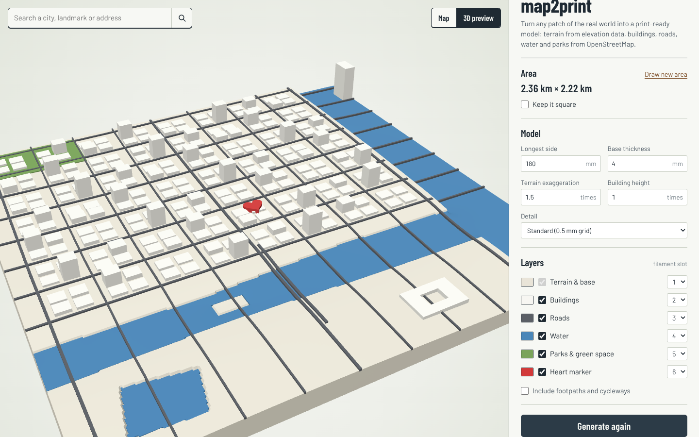
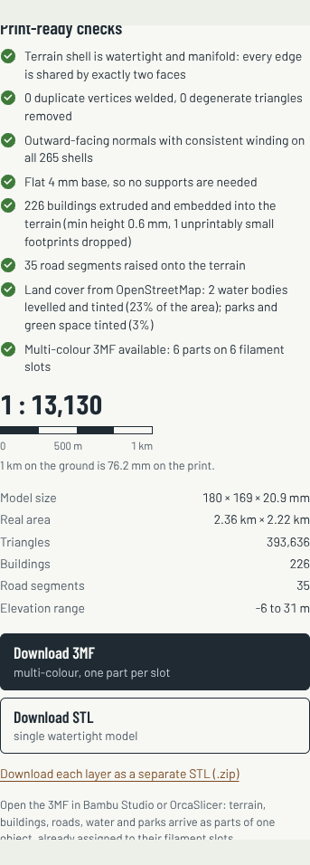

# map2print

**Turn any patch of the real world into a print-ready 3D model.** Drag a box on a map, press *Generate*, and download a true-to-scale, watertight model. Terrain comes from global elevation data. Buildings, roads, water and parks come from OpenStreetMap. Export it as a single STL or as a multi-colour 3MF that opens in Bambu Studio or OrcaSlicer with every layer already on its own filament (AMS) slot.

Everything runs in the browser. There's no server, account or upload.

**Live app:** https://madhav1233.github.io/map2print/



<sub>Preview of the synthetic test city that the end-to-end tests generate. It includes a river with an island, a bridge, a courtyard building, a coastline, a park and the optional heart marker.</sub>

## What it does

1. **Pick an area.** Search for a place (Nominatim), then drag a rectangle on the map. You can resize it from the corners, move it from the centre handle, or lock it to a square. The size is shown live in km. Each side can be up to 8 km.
2. **Set the print.** Choose the longest side in mm, the base thickness, terrain exaggeration, building height scale and grid detail. Then choose which layers to include and which filament slot each one uses.
3. **Generate.** The app downloads elevation tiles and OpenStreetMap data, then builds the meshes in a Web Worker. You get a 3D preview and a print-readiness report:
   - The terrain shell is watertight and manifold: every edge is shared by exactly two faces, with consistent winding.
   - Duplicate vertices are welded and degenerate triangles removed.
   - Every shell (each building, road segment and tint slab) gets outward-facing normals, checked by signed volume.
   - The base is flat, so no supports are needed.
   - Buildings are extruded to their OSM `height` / `building:levels` and embedded into the terrain. There's a minimum printable height, and footprints too small to print are dropped.
   - Roads are raised onto the terrain and draped along the ground, so they follow hills.
   - Rivers, lakes, harbours and the sea (built from OSM coastlines) are levelled and recessed. Parks and green space are tinted.
   - The report also shows model size, print scale (with a graphic scale bar), triangle count, building count, road segments and elevation range.
4. **Download.**
   - **3MF (multi-colour)**: one object made of terrain, buildings, roads, water, parks and marker parts, each assigned to its slot.
   - **STL**: a single model (terrain, buildings, roads and marker) that slices in any slicer.
   - **Separate STLs (.zip)**: one file per layer, all sharing the same origin.

An optional **heart marker** can be dragged onto the map to mark a special place. It prints as its own colour.



## How it works

```
Leaflet map ─► bbox ─► Terrain Tiles (Terrarium PNG) ─┐
                    └► Overpass API (out geom JSON) ──┤
                                                      ▼  Web Worker
           local equirectangular projection → model millimetres
           heightfield grid (0.4–0.8 mm) sampled from the DEM
           OSM parsing: multipolygon ring assembly, coastline → sea polygons
           water / park masks (scanline rasterisation) → water levelling
           solids: terrain, tint slabs, extruded buildings, road ribbons, marker
           clean-up: weld, drop degenerates, edge-manifold + volume check per shell
                                                      ▼
                          three.js preview · STL / 3MF / zip export
```

| Module | Responsibility |
| --- | --- |
| `src/core/projection.ts` | Lon/lat ↔ model mm, Web Mercator tile maths, Terrarium decoding |
| `src/core/osm.ts` | Overpass JSON → buildings, roads, water, coastlines, parks. Assembles multipolygon rings and parses heights |
| `src/core/coastline.ts` | Clips coastline chains to the window and walks the edge clockwise to build sea polygons (OSM: land on the left) |
| `src/core/grid.ts` | Terrain grid, polygon/line rasterisation, water levelling (flat for lakes and sea, harmonic surface for sloping rivers) |
| `src/core/solids.ts` | Closed-solid builders: heightfield solid, mask slabs (with diagonal pinch handling), polygon extrusion, road ribbons |
| `src/core/mesh.ts` | Welding, degenerate removal, manifold and orientation analysis |
| `src/core/generate.ts` | The pipeline and the print-readiness report |
| `src/core/export.ts` | Binary STL, Bambu/Orca-style 3MF (`3D/Objects/object_1.model` plus `Metadata/model_settings.config`), zip |
| `src/fetchers.ts` | Tile download and decode, Overpass with endpoint fallback, Nominatim search |
| `src/mapView.ts`, `src/preview.ts`, `src/main.ts` | Map selection, three.js preview, UI |

### Modelling choices

- **Scale.** The longest side maps to your chosen size. Buildings use true scale (times the building-height factor). Terrain can be exaggerated, because cities are usually flat at 1:15,000.
- **Water** is recessed 0.8 mm below the shoreline. In the 3MF, a 0.4 mm water part fills it back up in its own colour. Each connected water body gets one level from a low percentile of its shoreline. This also removes bathymetry in the elevation data. A river whose banks drop more than about 5 m gets a smooth, sloping surface instead.
- **Overlaps.** Buildings, roads, water and parks are separate closed shells that sink into the terrain so they fuse when printed. The overlaps are below the visible surface, so the slicer's handling of overlapping parts doesn't change what you see.
- **Printability limits** (in `src/core/types.ts`): minimum building height 0.6 mm, minimum footprint 0.5 mm², minimum road width 0.6 mm.

## Development

```bash
npm install
npm run dev          # http://localhost:5173
npm test             # unit tests: solids, OSM parsing, coastline, full pipeline, exporters
npm run build        # type-check and build into dist/
npm run test:e2e     # Playwright: drives the built app with every network service mocked
```

The tests don't need network access. `tests/fixtures/synthetic.ts` generates a small coastal city (OSM JSON plus Terrarium-encoded elevation tiles). The unit and end-to-end tests check that every exported part is closed, edge-manifold and outward-facing.

Pushing to `main` runs the tests and deploys `dist/` to GitHub Pages (`.github/workflows/deploy.yml`).

## Limitations

- The Overpass API is shared and rate-limited. Very dense or very large areas can time out. The app tries three public endpoints before giving up.
- Roofs are flat. `building:part` and roof shapes aren't modelled yet.
- Water and park edges follow the terrain grid, so they're as sharp as the chosen detail (0.4–0.8 mm). That's about one nozzle width.
- Bridges are draped at the water surface rather than lifted.
- Elevation data quality depends on the region. Terrain Tiles mix data from 3 m (parts of the US) to 30–90 m (global SRTM/GMTED).

## Data and credits

- Map data © [OpenStreetMap contributors](https://www.openstreetmap.org/copyright), available under the ODbL. If you share or sell prints, include this attribution.
- Elevation: [Terrain Tiles on AWS Open Data](https://registry.opendata.aws/terrain-tiles/) (Mapzen/Tilezen; sources include USGS 3DEP, SRTM, GMTED2010, ETOPO1, EU-DEM and others).
- Basemaps: OpenStreetMap standard tiles and [OpenTopoMap](https://opentopomap.org) (CC-BY-SA). Geocoding by Nominatim. No API keys are needed anywhere.
- Inspired by printpal's *Real-World 3D Map Generator*.

## License

MIT © Madhav Rajesh
